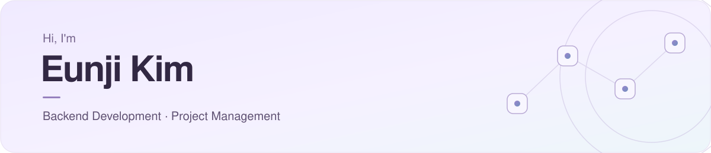

  

 

<h2 align="center">About Me</h2>

  IT경영과 컴퓨터공학을 복수전공하며 
  백엔드 개발자와 PM을 목표로 공부하고 있습니다.

  경영의 시선으로 문제를 발견하고, 개발을 통해 해결하는 데 관심이 있습니다. 
  일상의 작은 불편부터 사회의 복잡한 문제까지 
  더 나은 방향으로 바꾸는 것이 제 개발 모토입니다.

 

<h2 align="center">Contact</h2>

  
  &nbsp;
  
  &nbsp;
  

 
